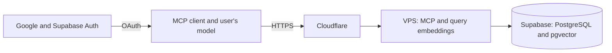

# MCP-ASIR

[Español](README.md)

An MCP server for querying educational materials from ASIR (a Spanish
vocational program in computer systems and network administration), using
hybrid search and source references. The project explores how to connect a
private document corpus to AI clients without giving them direct access to the
database or the educational platform.

> The code is public; the corpus is not. Access to the deployed server requires
> individual approval. To request access, email
> [me@raulcn.com](mailto:me@raulcn.com) with your Google account address.

## What it does

- Extracts and chunks documents while preserving provenance and locations.
- Combines lexical and semantic search and retrieves passages with citations.
- Exposes read-only MCP tools, without shell access or arbitrary SQL.
- Controls access per user and subject, with individual revocation.
- Supports retrieval and coverage evaluation; results do not guarantee that a
  generated answer is correct.



Document embeddings are prepared ahead of time. The VPS computes query
embeddings; Supabase stores the corpus and vectors and runs searches. Ingestion
and OCR can also run locally. Credentials, original documents, derived text,
and private evaluation references are not included in this repository.

## Connecting

The [landing page](https://asir.bztracker.xyz/) explains how to add the server
to a compatible client. Signing in with Google or accepting the consent screen
does not automatically grant access: the owner must approve the account. MCP
clients vary in their support for OAuth and remote connectors.

## Running the tests

Python 3.12 or later and Node.js are required for the consent-page test. Pinned
dependencies may vary by platform; they have been tested on Linux with Python
3.14.

```bash
python3 -m venv .venv
.venv/bin/pip install -r requirements-mcp.txt
.venv/bin/python -m unittest discover -s tests
node --test tests/test_oauth_consent.js
```

The tests use synthetic data and do not need access to the production corpus.
Running the service with real data also requires prepared indexes, a model,
private configuration, and a database; no sample corpus is included. See
[architecture and operations](docs/arquitectura.md) (in Spanish).

## Repository structure

| Path | Contents |
| --- | --- |
| `scripts/` | Ingestion, indexing, search, MCP server, and administration |
| `landing/` | Landing page and OAuth consent screen |
| `deploy/` | Proxy and OAuth configuration examples |
| `evaluation/` | Generic development questions, without private references |
| `tests/` | Tests using simulated data |
| `docs/` | Architecture, access, and limitations in Spanish |

## Limitations and responsible use

This is an educational project. Retrieved documents are untrusted data, not
instructions to the agent. OCR can make mistakes, and retrieval can miss or
misinterpret content; always check the sources. A client using an external AI
provider may send retrieved passages to that provider and consume its quota.
Only index and share material when you have permission, respecting personal
data and applicable terms.

The project was developed with AI assistance; its author is responsible for
the decisions, review, and publication.
