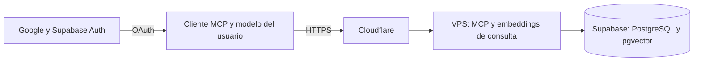

# MCP-ASIR

[English](README-EN.md)

Servidor MCP para consultar materiales de Administración de Sistemas
Informáticos en Red (ASIR) mediante búsqueda híbrida y respuestas con fuentes.
El proyecto explora cómo conectar un corpus documental privado con clientes de
IA sin entregarles acceso directo a la base de datos ni a la plataforma educativa.

> El código es público; el corpus no lo es. El acceso al servidor desplegado
> requiere aprobación individual. Para solicitarlo, escribe a
> [me@raulcn.com](mailto:me@raulcn.com) indicando tu cuenta de Google.

## Qué hace

- Extrae y fragmenta documentos, conservando procedencia y localizadores.
- Combina búsqueda léxica y semántica y permite consultar fragmentos con citas.
- Expone herramientas MCP de lectura, sin shell ni SQL arbitrario.
- Controla el acceso por usuario y asignatura, con revocación individual.
- Permite evaluar recuperación y cobertura; los resultados no garantizan que
  una respuesta generada sea correcta.



Los embeddings de documentos se preparan previamente. El VPS calcula los de
las consultas; Supabase almacena el corpus y los vectores y ejecuta la búsqueda.
La ingestión y el OCR también pueden ejecutarse localmente. Las credenciales,
documentos originales, texto derivado y referencias privadas de evaluación no
forman parte de este repositorio.

## Conectarse

La [landing](https://asir.bztracker.xyz/) explica cómo añadir el servidor a un
cliente compatible. Iniciar sesión con Google o aceptar el consentimiento no
concede acceso automáticamente: el propietario debe aprobar la cuenta. No todos
los clientes MCP tienen el mismo soporte para OAuth o conectores remotos.

## Ejecutar las pruebas

Se necesita Python 3.12 o posterior y Node.js para la prueba de consentimiento.
Los requisitos fijados pueden depender de la plataforma; se han probado en Linux
con Python 3.14.

```bash
python3 -m venv .venv
.venv/bin/pip install -r requirements-mcp.txt
.venv/bin/python -m unittest discover -s tests
node --test tests/test_oauth_consent.js
```

Las pruebas emplean datos ficticios y no necesitan acceder al corpus de
producción. Ejecutar el servicio con datos reales requiere además preparar
índices, modelo, configuración privada y base de datos; no hay un corpus de
ejemplo incluido. Consulta [arquitectura y operación](docs/arquitectura.md).

## Estructura

| Ruta | Contenido |
| --- | --- |
| `scripts/` | Ingestión, indexación, búsquedas, servidor MCP y administración |
| `landing/` | Presentación y pantalla de consentimiento OAuth |
| `deploy/` | Ejemplos de proxy y configuración OAuth |
| `evaluation/` | Preguntas genéricas de desarrollo, sin referencias privadas |
| `tests/` | Pruebas con datos simulados |
| `docs/` | Arquitectura, acceso y limitaciones |

## Límites y uso responsable

Este proyecto es educativo. Los documentos recuperados son datos no fiables,
no instrucciones para el agente. El OCR puede equivocarse y la recuperación
puede omitir o interpretar mal contenido; revisa siempre las fuentes. Un cliente
que use un proveedor de IA externo puede enviarle los fragmentos recuperados y
consumir su cuota. Solo deben indexarse y compartirse materiales para los que se
tenga permiso, respetando los datos personales y los términos aplicables.

El proyecto se desarrolló con asistencia de IA; las decisiones, la revisión y
la responsabilidad de su publicación corresponden a su autor.
